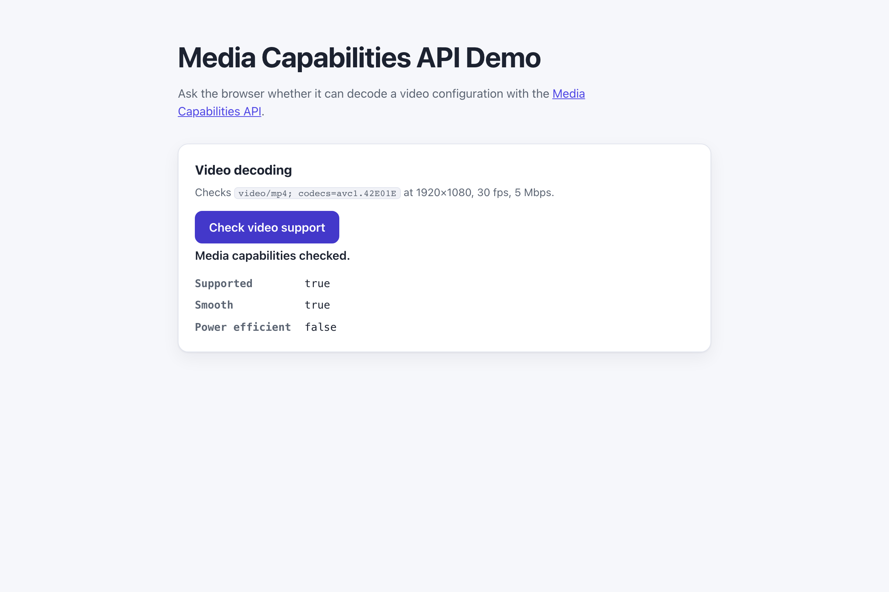

# WebSharper.MediaCapabilities

[](https://github.com/dotnet-websharper/MediaCapabilities)

WebSharper bindings for the [Media Capabilities API](https://developer.mozilla.org/en-US/docs/Web/API/Media_Capabilities_API) —
asking the browser whether it can decode or encode a media configuration from F# and C# web apps.

This repository contains:

| Project | Purpose |
| --- | --- |
| `WebSharper.MediaCapabilities` | The binding: WIG definitions for `MediaCapabilities`, `MediaCapabilitiesInfo`, `MediaDecodingConfig`, `MediaEncodingConfig`, `AudioInfo`, `VideoInfo`, `AudioConfig`, `VideoConfig`, and `MediaKeySystemConfig`. |
| `WebSharper.MediaCapabilities.Extensions` | `[<Inline>]` client extensions: `Navigator.MediaCapabilities` and `WorkerNavigator.MediaCapabilities`. |
| `WebSharper.MediaCapabilities.Sample` | An ASP.NET Core SPA that checks a 1080p video configuration. |

## Live demos

**Try it live:** [Open the sample in your browser](https://dotnet-websharper.github.io/MediaCapabilities/)



The sample doubles as the binding's test case: it calls `decodingInfo()` and reports whether the configuration is
supported, smooth, and power efficient.

- **Sample (this repository):** <https://dotnet-websharper.github.io/MediaCapabilities/>
- **Source repository:** <https://github.com/dotnet-websharper/MediaCapabilities>
- **WebSharper bindings:** <https://websharper.com/bindings>

## Features

- `MediaCapabilities.decodingInfo()` and `MediaCapabilities.encodingInfo()`.
- `MediaCapabilitiesInfo` (`supported`, `smooth`, `powerEfficient`, `keySystemAccess`).
- `MediaDecodingConfig` and `MediaEncodingConfig` with `type`, `audio`, `video`, and `keySystemConfiguration`.
- `VideoInfo` and `AudioInfo` (`contentType`, `width`, `height`, `bitrate`, `framerate`, `channels`, `samplerate`).
- `AudioConfig` / `VideoConfig` for `MediaKeySystemConfig` (`keySystem`, `initDataType`, `distinctiveIdentifier`, `persistentState`, `sessionTypes`, `audio`, `video`).

## Installation

The binding is not currently published to NuGet. Reference the projects from source:

```bash
git clone https://github.com/dotnet-websharper/MediaCapabilities.git
```

```xml
<ItemGroup>
  <ProjectReference Include="path/to/WebSharper.MediaCapabilities/WebSharper.MediaCapabilities.fsproj" />
  <ProjectReference Include="path/to/WebSharper.MediaCapabilities.Extensions/WebSharper.MediaCapabilities.Extensions.fsproj" />
</ItemGroup>
```

## Usage

```fsharp
namespace WebSharper.MediaCapabilities.Demo

open WebSharper
open WebSharper.JavaScript
open WebSharper.MediaCapabilities

[<JavaScript>]
module Demo =
    let checkMedia () =
        promise {
            let config =
                MediaDecodingConfig(
                    Type = "file",
                    Video = VideoInfo(
                        ContentType = "video/mp4; codecs=avc1.42E01E",
                        Width = 1920,
                        Height = 1080,
                        Bitrate = 5000000,
                        Framerate = 30
                    )
                )

            let! result = JS.Window.Navigator.MediaCapabilities.DecodingInfo(config)
            Console.Log($"Supported: {result.Supported}, Smooth: {result.Smooth}, Power efficient: {result.PowerEfficient}")
        }
```

The `Navigator.MediaCapabilities` and `WorkerNavigator.MediaCapabilities` extensions are declared in the Extensions
assembly.

## Running the sample

Build the sample in Release and serve its static output:

```bash
dotnet build WebSharper.MediaCapabilities.Sample/WebSharper.MediaCapabilities.Sample.fsproj -c Release
python3 -m http.server -d WebSharper.MediaCapabilities.Sample/wwwroot 8099
```

Open <http://localhost:8099/> and click **Check video support** to see the result.

Alternatively, run the ASP.NET Core host:

```bash
dotnet run --project WebSharper.MediaCapabilities.Sample
```

## Building from source

### Prerequisites

- [.NET SDK 10](https://dotnet.microsoft.com/download) or later.

### Build

```bash
dotnet build WebSharper.MediaCapabilities.sln -c Release
```

The binding projects target `netstandard2.0`; the sample targets `net10.0`.

## Deployment

Pushing to `main` triggers `.github/workflows/ghpages.yml`, which builds the sample in Release and publishes
`WebSharper.MediaCapabilities.Sample/wwwroot` to the `gh-pages` branch.

## Repository layout

```
WebSharper.MediaCapabilities/              # binding (WIG definitions)
  Main.fs
WebSharper.MediaCapabilities.Extensions/   # [<Inline>] client extensions
  Library.fs
WebSharper.MediaCapabilities.Sample/       # ASP.NET Core SPA demo
  Client.fs
  Startup.fs
  wwwroot/
    index.html
    site.css
.github/workflows/ghpages.yml              # build + deploy the sample to GitHub Pages
```

## Notes on the API

- **Configuration:** `MediaDecodingConfig` and `MediaEncodingConfig` are dictionaries. Set `type` to `"file"` or
  `"media-source"`, and fill `audio` or `video` with the matching `AudioInfo` / `VideoInfo`.
- **Result:** `MediaCapabilitiesInfo` reports `supported`, `smooth`, and `powerEfficient`. These are hints; the
  browser may still choose a different decoder at playback time.
- **Key systems:** `keySystemConfiguration` describes an EME key system (for example Widevine) for the configuration.
- **Browser support:** the Media Capabilities API is not available in every browser; check the MDN compatibility
  table and handle the missing `navigator.mediaCapabilities`.

## License

Apache 2.0 — see [LICENSE.md](LICENSE.md).
